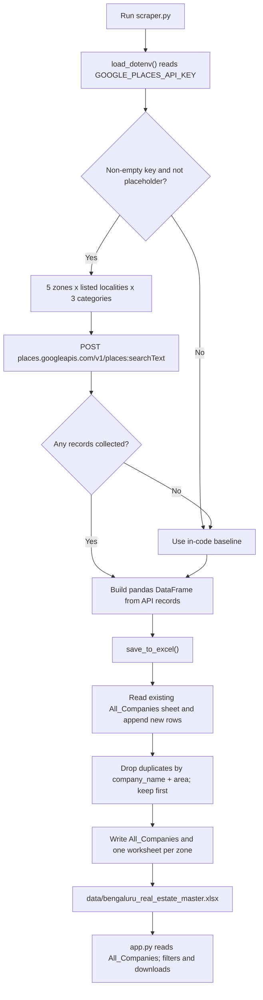
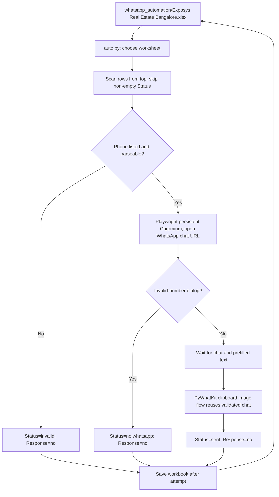

# Project Architecture

This document describes the architecture visible in the current repository.

## 1. System overview

```mermaid
flowchart LR
  ENV["Root .env\nGOOGLE_PLACES_API_KEY"] --> SCRAPER["scraper.py"]
  SCRAPER -->|Text search requests| PLACES["Google Places API (New)"]
  SCRAPER -->|No usable key or zero results| BASELINE["In-code 15-company baseline"]
  PLACES --> RECORDS["Lead records"]
  BASELINE --> RECORDS
  RECORDS --> EXCEL_HELPER["scripts/scrapers_excel.py\nmerge + deduplicate + split by zone"]
  EXCEL_HELPER --> MASTER["data/bengaluru_real_estate_master.xlsx"]
  MASTER --> DASH["app.py\nStreamlit dashboard"]
  MASTER -. fallback input .-> AUDIT["website_quality_audit/app.py"]
  AUDIT_INPUT["website_quality_audit/input/\nbengaluru_real_estate_master.xlsx"] --> AUDIT
  AUDIT --> CHECKER["website_checker.py\nHTTP, TLS, title, description"]
  CHECKER --> SCORER["scoring.py\n0-100 score + rating"]
  SCORER --> AUDIT_OUTPUT["website_quality_audit/output/\nwebsite_audit_full.xlsx"]
  OUTREACH_BOOK["whatsapp_automation/\nExposys Real Estate Bangalore.xlsx"] --> AUTO["whatsapp_automation/auto.py"]
  OUTREACH_BOOK --> VERIFY["whatsapp_automation/verify_numbers.py"]
  AUTO --> WWEB["WhatsApp Web\nPlaywright validation + PyWhatKit send"]
  VERIFY --> WWEB
  AUTO -->|Status + Response updates| OUTREACH_BOOK
  VERIFY -->|Status updates| OUTREACH_BOOK
```

## 2. Lead collection and dashboard data flow

The API loop issues one text-search request per locality/category pair (78 queries with the current lists). It does not follow pagination tokens. If at least one API record is collected, the baseline is not merged in. The hardcoded fallback is labeled as verified/RERA-derived in the data, but this code does not query a RERA API.

## 3. Website audit flow

```mermaid
flowchart LR
  LOCAL["website_quality_audit/input/bengaluru_real_estate_master.xlsx"] --> CHOOSE{"Input file exists?"}
  SHARED["data/bengaluru_real_estate_master.xlsx"] --> CHOOSE
  CHOOSE -->|Prefer local copy| AUDIT_APP["website_quality_audit/app.py"]
  CHOOSE -->|Otherwise shared fallback| AUDIT_APP
  AUDIT_APP --> URLS["Rows with non-empty website"]
  URLS --> CHECK["website_checker.py: requests.get + BeautifulSoup"]
  CHECK --> SCORE["scoring.py: availability, HTTPS, title, description, latency"]
  SCORE --> PRESERVE["Preserve original workbook sheets"]
  PRESERVE --> RESULT["website_quality_audit/output/website_audit_full.xlsx"]
```

The local audit input workbook currently takes precedence when present, so it can become stale relative to the master workbook. The audit module's .env.example mentions Google Places, but the audit code does not load or use that key.

## 4. WhatsApp outreach flow

`verify_numbers.py` is a separate, older GUI screenshot-based verifier. `auto.py` uses the same outreach workbook but sends messages and records per-row results.

## Data and configuration notes

- The root `.env` is used by `scraper.py`; the committed `.env.example` contains only a placeholder.
- The website audit reads its own `input/` workbook first and falls back to the root `data/` workbook only if the local file is absent.
- WhatsApp outreach uses a different workbook from the scraper/dashboard pipeline; there is no automatic synchronization between them.
- `data/raw/` and `data/processed/` are currently placeholder directories; the scraper writes directly to the master Excel workbook.
- Live API emails are synthesized from company names, and the code labels returned Places records as `Verified`; those labels are not independently verified by this repository.
